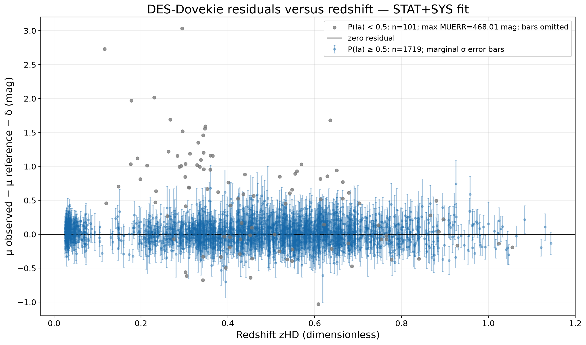

# Supernova Analyzer

A light-curve and catalogue-analysis app: SALT3 fits for single supernovae, and residual analysis of two public supernova catalogues (DES-Dovekie and Pantheon+) with their full covariance.

Built with AI coding agents (Claude, Codex); tests and verification by me.



DES-Dovekie residuals from the full STAT+SYS precision-matrix analysis.

## Results

| Check | Result | Source |
|---|---|---|
| SALT3 injection–recovery, 100 synthetic light curves with known parameters (fixed seed) | 100 of 100 fits converged. For t0, x1, c and m_B the mean offset from the truth was smaller than the sample scatter (and within one standard error of the mean) | `reports/verification_2026-11-06/summary.json` (`steps.C_salt3_injection_recovery`), `REPORT.md` §C |
| DES-Dovekie | 1,820 release rows analysed with the full STAT+SYS precision matrix | `REPORT.md` §§D, G |
| Pantheon+ | 1,624 non-calibrator rows (1,701 released, 77 Cepheid calibrators excluded) analysed with the full STAT+SYS covariance | `REPORT.md` §§E, G |
| Independent recomputation from the raw release files | Every reported catalogue statistic reproduced to the last printed digit; largest absolute difference 4.19×10⁻¹¹ | `reports/verification_2026-11-06/independent_recompute.py`, `independent_recompute.json` |
| Test suite (maintenance version 1.0.1) | 281 offline tests and 9 integration tests pass | `reports/verification_2026-11-06/maintenance_offline_pytest.txt`, `maintenance_integration_pytest.txt` |

The two catalogue row counts describe separate released samples; they are not added together or counted as unique supernovae.

## How it was verified

- **Known answers first.** 100 synthetic light curves with fixed true parameters, the bundled cadence and bands, and Gaussian noise from each row's supplied error were fitted with the app's own SALT3 fitter.
- **Full error models.** DES-Dovekie is analysed with its released precision matrix and Pantheon+ with its released covariance, in the exact released row order; the alignment is checked with an order-sensitive fingerprint.
- **A second route to the same numbers.** A standalone NumPy/Pandas script (`independent_recompute.py`) recomputes the catalogue headline statistics from the raw release files without importing this package.
- **Tests.** The offline suite covers the light-curve and catalogue loaders, the fitters, covariance handling, the residual analysis and the Streamlit app. The integration suite runs on the official files and a real SALT3 model.

The full verification report, with every command, figure and log, is `reports/verification_2026-11-06/REPORT.md`.

## Limits

- An educational single-object and descriptive catalogue-analysis tool. It does not infer H0 or cosmological parameters, build a joint likelihood, or test the significance of cosmological tensions.
- The injection check uses the bundled example cadence and noise model. A successful fit is a software check, not a claim of survey performance.
- The illustrative sample redshift and standardisation constants are demonstration assumptions, not external measurements or survey calibrations.
- DES-Dovekie `MU` and Pantheon+ `MU_SH0ES` use different absolute-magnitude conventions, so their roughly 0.1 mag intercept difference is a zero-point convention, not an H0 measurement.

## Run it

Python 3.11 or newer.

```sh
git clone https://github.com/hyh4867/supernova-analyzer.git
cd supernova-analyzer
python3 -m venv .venv && . .venv/bin/activate
python -m pip install -e ".[dev]"
python -m pytest -m "not integration"
streamlit run app.py
```

The offline tests (281) use only the synthetic and example data in `data/`. The 9 integration tests need the official catalogue files and download the SALT3 model through sncosmo; they were not re-run for this repository. To run them, download the releases (below), point these variables at the files and set `RUN_SNCOSMO_INTEGRATION=1`:

- DES-Dovekie: `DES_DOVEKIE_HD_PATH`, `DES_DOVEKIE_METADATA_PATH`, `DES_DOVEKIE_STAT_SYS_PATH`
- Pantheon+: `PANTHEONPLUS_DATA_PATH`, `PANTHEONPLUS_STAT_SYS_PATH`
- Legacy DES-SN5YR: `DES_SN5YR_CATALOG_PATH`, `DES_SN5YR_STAT_SYS_PATH`, `DES_SN5YR_STATONLY_PATH`

```sh
RUN_SNCOSMO_INTEGRATION=1 python -m pytest -m integration
```

File formats and the expected files are described in `docs/dovekie_analysis.md`, `docs/pantheonplus_analysis.md` and `docs/population_catalog.md`.

## Data, citation and licenses

The official catalogues are not redistributed here; the app reads the files you download.

| Data | Source | Terms |
|---|---|---|
| DES-Dovekie distances and precision matrices | [github.com/des-science/DES-SN5YR](https://github.com/des-science/DES-SN5YR) | No license file in the repository; download from the source. |
| DES-SN5YR legacy release | Zenodo [10.5281/zenodo.12720778](https://doi.org/10.5281/zenodo.12720778) | CC BY 4.0 |
| Pantheon+SH0ES distances and covariance | [github.com/PantheonPlusSH0ES/DataRelease](https://github.com/PantheonPlusSH0ES/DataRelease/tree/main/Pantheon%2B_Data/4_DISTANCES_AND_COVAR) | No license file in the repository; download from the source. |
| SALT3 model | Downloaded at run time by sncosmo | See the sncosmo model registry. |

Bundled data: `data/sample_light_curve.csv` is synthetic; `data/scientific/sample_multiband_photometry.csv` is the example photometry shipped with sncosmo (`sncosmo.load_example_data()`, BSD-3-Clause).

When using the releases, cite:

- DES Collaboration (Abbott et al.), The Dark Energy Survey: Cosmology Results with ~1500 New High-redshift Type Ia Supernovae Using the Full 5 yr Data Set, *ApJL* 973, L14 (2024), [doi:10.3847/2041-8213/ad6f9f](https://doi.org/10.3847/2041-8213/ad6f9f).
- Sánchez et al., The Dark Energy Survey Supernova Program: Light Curves and 5 Yr Data Release, *ApJ* 975, 5 (2024), [doi:10.3847/1538-4357/ad739a](https://doi.org/10.3847/1538-4357/ad739a).
- Vincenzi et al., The Dark Energy Survey Supernova Program: Cosmological Analysis and Systematic Uncertainties, *ApJ* 975, 86 (2024), [doi:10.3847/1538-4357/ad5e6c](https://doi.org/10.3847/1538-4357/ad5e6c).
- Scolnic et al., The Pantheon+ Analysis: The Full Data Set and Light-curve Release, *ApJ* 938, 113 (2022), [doi:10.3847/1538-4357/ac8b7a](https://doi.org/10.3847/1538-4357/ac8b7a).
- Brout et al., The Pantheon+ Analysis: Cosmological Constraints, *ApJ* 938, 110 (2022), [doi:10.3847/1538-4357/ac8e04](https://doi.org/10.3847/1538-4357/ac8e04).
- Kenworthy et al., SALT3: An Improved Type Ia Supernova Model for Measuring Cosmic Distances, *ApJ* 923, 265 (2021), [doi:10.3847/1538-4357/ac30d8](https://doi.org/10.3847/1538-4357/ac30d8).

For DES-Dovekie, also follow the citation guidance in the DES-SN5YR repository.

Dependencies: Astropy, SciPy, NumPy, pandas and sncosmo (BSD-3-Clause), Matplotlib (PSF-based), Streamlit (Apache-2.0), iminuit (MIT, with the bundled Minuit2 under LGPL-2.1-or-later).

Code: MIT License, see `LICENSE`.
