# Supernova Analyzer: Source Analysis and Verification

> Edited for publication: local absolute paths were replaced with `<project>` and `~/.cache`, and the pytest temporary directories and an agent review note were left out. All numbers and results are unchanged.

**Run date:** 2026-11-06  
**Source-analysis base:** `main`; maintenance and report corrections on local branch `supernova-maint-1.0.1`  
**Change boundary:** numerical/app behavior and official data were not edited; only one test was made hermetic. Generated files are in this report directory, locally excluded by `.git/info/exclude`.

> **요약:** 코드·수치 동작과 공식 데이터는 유지했습니다. A1에서 Streamlit 통합 테스트에 공식 데이터 경로가 새어 들어가던 원인을 확인하고 네 경로를 테스트에서 격리했습니다. 아래에는 수정 후 전체 검증 결과를 기록합니다. 카탈로그 비교는 기술통계이며 H0 추론·공동 우도·긴장도 유의도 계산을 하지 않습니다.

## Executive summary

The application is an educational single-supernova analysis and descriptive Hubble-residual explorer. The source implements sampled peak detection, interpolated 15-day decline, pinned SALT3 fitting, and release-specific DES-Dovekie and Pantheon+ distance-modulus pipelines. On the local official files DES-Dovekie uses 1,820 rows; Pantheon+ uses 1,624 non-calibrator rows (zHD 0.00299–2.26137) after excluding 77 calibrators from 1,701 rows. A standalone NumPy/Pandas script independently recomputed the full-matrix results from raw files. The Streamlit test issue was data-path leakage from other tabs; its test now clears the four official-data path variables. Matrix-diagonal comparisons use the full matrix's row-wise marginal variances, as detailed below.

## Maintenance diagnosis (A1–A4)

- **A1 — Streamlit assertion:** Before the test was made hermetic, the three `app.success` texts at its failing assertion (`tests/test_streamlit_app.py:133` before the edit; now line 143) were `DES-Dovekie data available` from Cross-Catalog Explorer (`app.py:799`), `Pantheon+ data available` (`app.py:804`), and `Both catalogs available — analysis ready` (`app.py:824`). Scientific-tab `Analysis complete.` (`app.py:720`) was absent after the fixed-redshift input change; stale-state handling returned at `app.py:713-714`. With the four official path variables unset, the original test passed. The test now deletes all four using `monkeypatch`.
- **A2 — diagonal-only variance:** The report's diagonal approximation uses DES `diag(P⁻¹)` (`run_analysis.py:543-547`) and Pantheon+ `diag(C)` (`:568-571`), passed to `_diag_result` (`:489-495`). It does not use `MUERR²` or `MU_SH0ES_ERR_DIAG²`. This approximation exists in the report harness only; the app uses full-matrix catalog pipelines.
- **A3 — bundled SALT3 sample:** The 40-row bundled CSV matches `sncosmo.load_example_data()` exactly in values and metadata: z=0.5, t0=55100, x0=1.20482820761e-05, x1=0.5, c=0.2. See `A3_sample_comparison.txt`; comparison used sncosmo 2.13.0.
- **A4 — DES `MUERR` bars:** No Streamlit app plot draws DES `MUERR` error bars. Cross-Catalog Explorer uses scatter/summary plots (`app.py:858-905`; `cross_catalog.py:300-330`). The separate Dovekie CLI plot path passes its normalized `MUERR` column (`scripts/run_dovekie_precision_analysis.py:98-118`; `dovekie_io.py:285-303`); the helper caps displayed error bars at the 95th percentile (`hubble_analysis.py:696-738,767-815`). The report redraw instead uses marginal `sqrt(diag(P⁻¹))` bars for `PROBIA_BEAMS≥0.5` and gray unbarred points below the threshold.

## Part 1 — Program anatomy from source

### 1.1 Project purpose and entry points

The code is a conventional scientific Python application, not an AI inference program. Its single-object side reads magnitude or multi-band flux observations, calculates elementary light-curve quantities, and fits the empirical SALT3 model. Its catalog side compares released distance moduli to a fixed flat-ΛCDM reference and fits a separate additive nuisance intercept for each catalog. It creates tables, plots, JSON summaries, and Streamlit downloads.

**Streamlit entry point:** `streamlit run app.py`. At `app.py:941-949`, it creates three tabs: Basic Analysis, Scientific SALT3 Fit, and Cross-Catalog Explorer.

- Basic tab call chain: `_render_basic_tab` (`app.py:135`) → `load_light_curve` (`src/supernova_analyzer/io.py:10`) → `detect_observed_peak` and `calculate_dm15_linear` (`analysis.py:60,89`) → `plot_light_curve` (`plotting.py:12`) → summary/JSON helpers in `app_services.py`.
- SALT3 tab call chain: `_render_scientific_tab` (`app.py:554`) → `load_scientific_photometry` (`scientific_io.py:32`) → `fit_salt3` (`salt3_fitting.py:147`) → `calculate_salt3_diagnostics` and plotting (`salt3_diagnostics.py:74,453`) → `calculate_salt3_amplitude_magnitude` and `calculate_tripp_standardization` (`standardization.py:203,402`) → app summaries/downloads.
- Catalog UI call chain: `_render_cross_catalog_tab` (`app.py:773`) → `catalog_availability`/`load_validated_results` (`cross_catalog_ui.py:47,75`) → release I/O adapters → precision/covariance residual pipeline → `compare_catalog_residuals` and plots (`cross_catalog.py:213,286-335`).

**Command-line entry points:** seven scripts are under `scripts/`. `run_hubble_analysis.py` handles legacy DES diagonal analysis; `run_hubble_covariance_analysis.py` runs generic full covariance analysis; `run_dovekie_precision_analysis.py` runs DES-Dovekie precision analysis; `run_pantheonplus_covariance_analysis.py` runs Pantheon+ covariance analysis; `run_cross_catalog_comparison.py` composes the two official pipelines; `validate_cross_catalog_reproducibility.py` checks release reproducibility and H0 invariance, writing a manifest only when explicitly requested; `run_salt3_sample_fit.py` fits the bundled SALT3 sample.

### 1.2 File map, physical line counts, and responsibilities

Line counts are physical source lines (`wc -l`) on the analyzed tree. This inventory covers `app.py`, the root UI helper, every Python file under `src/`, `scripts/`, and `tests/`.

| File | LOC | Responsibility |
|---|---:|---|
| `app.py` | 949 | Three-tab Streamlit workflow, state, input controls, results, and downloads. |
| `cross_catalog_ui.py` | 187 | Cross-catalog path availability, validated loading, table shaping, and JSON export. |
| `src/supernova_analyzer/__init__.py` | 250 | Public API exports and package version. |
| `src/supernova_analyzer/analysis.py` | 140 | Validated sampled peak and linearly interpolated dm15 calculations. |
| `src/supernova_analyzer/app_services.py` | 259 | GUI input validation, fingerprints, JSON-ready summaries, and figure bytes. |
| `src/supernova_analyzer/covariance.py` | 406 | Full covariance loading, alignment, symmetry/positive-definite validation, and composition. |
| `src/supernova_analyzer/cross_catalog.py` | 346 | Residual summaries, overlap bins, minimum-count suppression, and comparison plots. |
| `src/supernova_analyzer/dovekie_io.py` | 304 | DES-Dovekie HD/metadata parsing, row alignment, normalization, and provenance. |
| `src/supernova_analyzer/hubble_analysis.py` | 947 | Reference cosmology, diagonal/full-covariance Hubble fits, residuals, and plots. |
| `src/supernova_analyzer/io.py` | 37 | Small magnitude light-curve CSV loader. |
| `src/supernova_analyzer/pantheonplus_analysis.py` | 278 | Pantheon+ covariance load/subset and diagonal-versus-full comparisons. |
| `src/supernova_analyzer/pantheonplus_io.py` | 312 | Pantheon+ table parsing, normalization, calibrator selection, and source-row tracking. |
| `src/supernova_analyzer/plotting.py` | 94 | Basic light-curve figure with peak and dm15 annotations. |
| `src/supernova_analyzer/population_io.py` | 348 | Legacy DES-SN5YR population catalog schema, quality summaries, and explicit cuts. |
| `src/supernova_analyzer/precision.py` | 523 | Packed precision matrix loading/alignment and GLS intercept/residual analysis. |
| `src/supernova_analyzer/salt3_diagnostics.py` | 553 | SALT3 model predictions, per-band residual diagnostics, and figures. |
| `src/supernova_analyzer/salt3_fitting.py` | 296 | Pinned sncosmo SALT3 fit and immutable result validation. |
| `src/supernova_analyzer/scientific_io.py` | 85 | Multi-band flux table schema and value validation. |
| `src/supernova_analyzer/standardization.py` | 495 | x0 amplitude magnitude, synthetic spectral diagnostics, and Tripp-like formula. |
| `scripts/run_cross_catalog_comparison.py` | 197 | CLI for official DES-Dovekie versus Pantheon+ residual comparison. |
| `scripts/run_dovekie_precision_analysis.py` | 267 | CLI for DES-Dovekie precision-matrix Hubble analysis. |
| `scripts/run_hubble_analysis.py` | 160 | CLI for legacy DES-SN5YR diagonal Hubble analysis. |
| `scripts/run_hubble_covariance_analysis.py` | 216 | CLI for general released covariance products. |
| `scripts/run_pantheonplus_covariance_analysis.py` | 355 | CLI for Pantheon+ covariance, calibrator exclusion, and fit outputs. |
| `scripts/run_salt3_sample_fit.py` | 161 | CLI for bundled multi-band SALT3 sample fitting. |
| `scripts/validate_cross_catalog_reproducibility.py` | 244 | Read-only hash/order/count/H0 invariance validator; optional JSON manifest. |

### 1.3 Data flow by feature

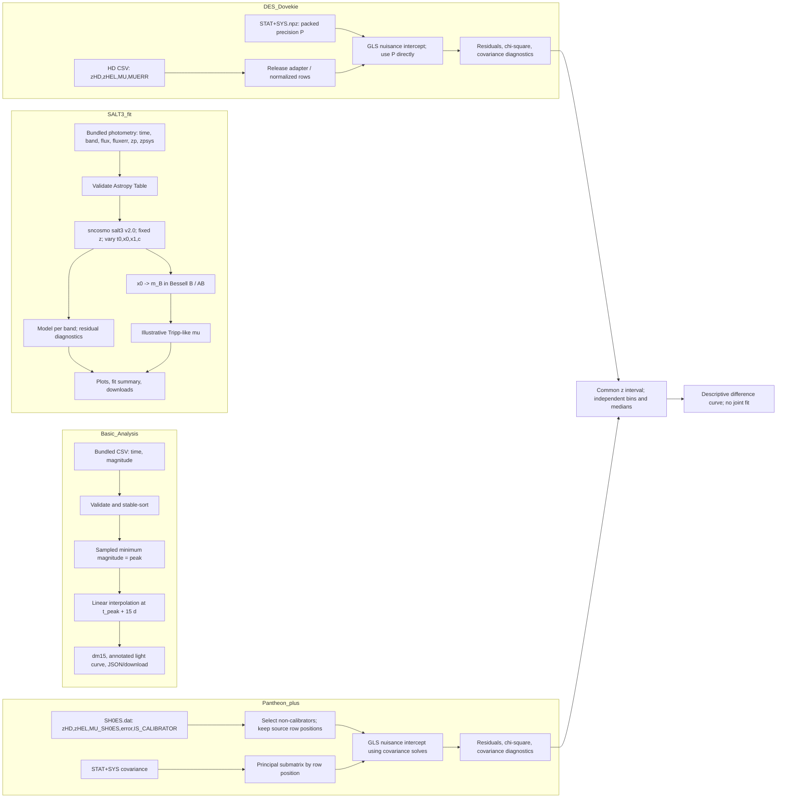

Plain-text flow:

- **Basic Analysis:** columns `time,magnitude` → finite-value check and stable time sort → earliest sampled minimum magnitude → `np.interp` at peak + 15 days → dm15 value, annotated light-curve plot, summary/JSON.
- **SALT3:** `time,band,flux,fluxerr,zp,zpsys` → validated Astropy table → pinned SALT3 model with fixed redshift → fit parameters/covariance and per-band predictions/residuals → x0-only B-band amplitude magnitude → illustrative Tripp-like value → charts, tables, JSON/downloads.
- **DES-Dovekie:** SNANA-style HD table fields `zHD,zHEL,MU,MUERR` plus a packed upper-triangle `STAT+SYS.npz` precision matrix → preserve release row order and normalize distances → use P directly in GLS → residuals, intercept, chi-square, plots, validation summary.
- **Pantheon+:** whitespace table fields `zHD,zHEL,MU_SH0ES,MU_SH0ES_ERR_DIAG,IS_CALIBRATOR` plus a row-major `STAT+SYS.cov` matrix → select `IS_CALIBRATOR == 0` in original order → subset C by retained source-row positions → Cholesky solves for GLS → residuals, intercept, chi-square, plots, validation summary. `MU_SH0ES_ERR_DIAG` is display-only; the report's marginal-diagonal approximation uses `diag(C)`, while the full fit uses C.
- **Cross-catalog:** the two independently fitted residual sets → common redshift intersection → equal-width bins → within-catalog medians and 16th/84th percentiles → DES median minus Pantheon+ median only when both per-bin counts meet the configured threshold → descriptive plot/JSON.

### 1.4 Methods as implemented

#### Peak and 15-day decline

For sorted observations ((t_i,m_i)), the peak is the earliest time-sorted row attaining (min_i m_i). This is a **sampled observed peak**, not a continuous or fitted maximum (`analysis.py:60-86`, `detect_observed_peak`). Then

\[
\mathrm{dm15}=m_{\mathrm{lin}}(t_{\mathrm{peak}}+15\,\mathrm{d})-m_{\mathrm{peak}},
\]

where `m_lin` is `numpy.interp` between observed samples. Duplicate times and extrapolation are rejected (`analysis.py:89-139`, `calculate_dm15_linear`). It is not a noise-aware decline fit.

#### SALT3 fit and single-object standardization

- Backend/library: `sncosmo` 2.13.0, SALT3 source name `salt3`, explicitly pinned source version `2.0` (`salt3_fitting.py:18-19,71-83,147-205`). The fitted redshift is fixed from the UI input, not estimated; the code varies only `(t0,x0,x1,c)`. Default bounds are `None` (no explicit parameter bounds supplied); custom bounds are an opt-in UI control. `guess_amplitude=True`, `guess_t0=True` unless initial t0 supplied, `guess_z=False`, default `min_snr=5`, and model covariance defaults on (`salt3_fitting.py:147-205`; UI defaults `app.py:585-607`).
- Bundled fit result at fixed demonstration z=0.5: `t0=55100.470310 ± 0.428665 d`; `x0=(1.175108 ± 0.044066)×10⁻⁵`; `x1=0.592213 ± 0.372595`; `c=0.229807 ± 0.033228`; χ²=32.127686 for 36 dof, reduced χ²=0.892436. 40/40 observations were used, with SALT3 model covariance enabled.
- Amplitude magnitude is `m_B = -2.5 log10(x0) + C` (`standardization.py:203-260`). C is derived by evaluating the same SALT3 source/version at `z=0,t0=0,x0=1,x1=0,c=0`, in Bessell B and AB (`standardization.py:178-200`). For this fit C=10.511372 mag and `m_B=22.836177 ± 0.040715 mag`.
- The code's Tripp-like formula is
  \[
  \mu=m_B-M+\alpha x_1-\beta c
  \]
  (`standardization.py:402-495`). UI/script demonstration values are α=0.14, β=3.1, M=−19.3 (`app.py:72-74`); these are explicitly not survey calibration values. For the bundled fit this gives illustrative μ=41.506686 mag.
- The fit has `x1` inside the broad Pantheon+ selection cut −3 < x1 < 3 and `c` inside −0.3 < c < 0.3; c=0.230 is near the positive boundary. These are broad release sample cuts, not a universal definition of a normal SN Ia ([Pantheon+ full dataset and light-curve release](https://arxiv.org/abs/2112.03863)).

#### Reference cosmology and catalog columns

`calculate_reference_distance_modulus` uses Astropy 8.0.1 `FlatLambdaCDM(H0=70 km s⁻¹ Mpc⁻¹, Om0=0.3)` by default; Ωm and H0 are fixed inputs, not fitted (`hubble_analysis.py:302-349`). For luminosity distance in Mpc,

\[
\mu_{\rm ref}=5\log_{10}\!\left(D_L/{\rm Mpc}\right)+25.
\]

When both redshifts are supplied, code evaluates (D_L(z_{HD}) (1+z_{HEL})/(1+z_{HD})) before converting to modulus. This is equivalent to retaining the Hubble-flow distance from zHD while applying the heliocentric frame factor. It is not an H0 measurement.

| Release | Cosmology redshift | Heliocentric field | Measured modulus used | Error column | Full matrix used for fit | Reason encoded by adapter |
|---|---|---|---|---|---|---|
| DES-Dovekie | `zHD` | `zHEL` | `MU` | `MUERR` for display; report marginal-diagonal approximation uses `diag(P⁻¹)` | `STAT+SYS.npz` is precision P | Release HD table maps these names directly; reference uses zHD with zHEL frame correction (`dovekie_io.py:285-303`). |
| Pantheon+SH0ES | `zHD` | `zHEL` | `MU_SH0ES` | `MU_SH0ES_ERR_DIAG` for display; marginal-diagonal comparison uses `diag(C)` | `Pantheon+SH0ES_STAT+SYS.cov` is covariance C | Adapter explicitly defines the SH0ES released modulus and zHD/zHEL convention (`pantheonplus_io.py:233-258`). |

The fit residual before the nuisance offset is (r=y-\mu_{ref}). For covariance C, the fitted intercept, its uncertainty, and post-fit chi-square are

\[
\delta=\frac{\mathbf{1}^{T}C^{-1}r}{\mathbf{1}^{T}C^{-1}\mathbf{1}},\qquad
\sigma_\delta=(\mathbf{1}^{T}C^{-1}\mathbf{1})^{-1/2},\qquad
\chi^2=(r-\delta\mathbf{1})^TC^{-1}(r-\delta\mathbf{1}),\quad\mathrm{dof}=N-1.
\]

For a precision matrix P, the same formulas use P in place of (C^{-1}). Code locations: covariance fit `hubble_analysis.py:516-650`; direct precision fit `precision.py:315-389`. Production code does not explicitly invert a covariance. It uses Cholesky-backed `cho_solve` for C, and direct matrix products for P. Diagonal-only comparison uses (W=\mathrm{diag}(1/\sigma_i^2)) (`hubble_analysis.py:352-392`).

#### Matrix loading, symmetry, and calibrator handling

- DES-Dovekie loader reads an NPZ with exactly `nsn`, `cov`, and `allow_pickle`; it opens with `allow_pickle=False`, treats `cov` as one-dimensional packed upper-triangle values, reflects them to a symmetric P, and does not invert P (`precision.py:159-232`). The `allow_pickle` scalar is metadata only, never permission to unpickle. The real release matrix is 1,820 × 1,820.
- Pantheon+ loader reads a leading dimension followed by exactly N² row-major numbers; it validates symmetry within the release-specific tolerance and positive definiteness without symmetrizing or adding a diagonal (`covariance.py:172-238`, `pantheonplus_analysis.py:67-93`). Cholesky factors are used for fits (`hubble_analysis.py:516-650`).
- Pantheon+ selects `IS_CALIBRATOR == 0` with `np.flatnonzero`, preserving original source positions (`pantheonplus_io.py:261-286`). The covariance subset is a principal submatrix via `np.ix_(positions,positions)` in that retained-row order (`pantheonplus_analysis.py:96-137`). No row sorting, deduplication, or extra diagonal is applied. Result: 77 calibrators excluded; 1,624 of 1,701 rows retained.

#### Cross-catalog comparison

`compare_catalog_residuals` intersects the two catalog ranges, then makes 10 equal-width bins by default and requires at least 5 objects from **each** catalog before returning a bin difference (`cross_catalog.py:159-261`). Per-catalog bin statistics are median residual and 16th/84th percentiles; the difference is DES-Dovekie median minus Pantheon+ median. The summary additionally reports arithmetic mean, median, RMS, and scaled MAD (1.4826\,\mathrm{median}(|r-\mathrm{median}(r)|)) (`cross_catalog.py:126-156`). The final bin includes its upper edge. Underpopulated paired bins return no difference. There is no object cross-match, shared covariance, or joint likelihood.

### 1.5 Test inventory and coverage limits

Counts below are collected pytest items in the offline suite plus the separately collected integration marker suite. Offline: 281 items. Integration: 9 items. The integration command executed all nine; one failed. `tests/conftest.py` contains no tests.

| Test module | LOC | Offline | Integration | What it verifies |
|---|---:|---:|---:|---|
| `conftest.py` | 5 | — | — | Shared pytest setup: selects Matplotlib Agg backend. |
| `test_analysis.py` | 97 | 13 | 0 | Peak tie/order/validation behavior and input immutability. |
| `test_app_services.py` | 274 | 21 | 0 | Fingerprints, GUI number/bounds checks, JSON, summaries, figure bytes. |
| `test_covariance.py` | 239 | 16 | 1 | Matrix parsing, symmetry/SPD, alignment, composition, no inverse; real legacy covariance run. |
| `test_cross_catalog.py` | 254 | 9 | 1 | Statistics, overlap/bins, boundary/min-count, independent intercept/H0 invariance; real catalogs. |
| `test_cross_catalog_quality.py` | 314 | 10 | 0 | Row conservation, minimum-count behavior, bin edges, invariance, descriptive scope. |
| `test_cross_catalog_ui.py` | 149 | 5 | 1 | Availability, error display, JSON-safe bins; official-data UI rendering. |
| `test_dm15.py` | 106 | 9 | 0 | Interpolation and no extrapolation/invalid input cases. |
| `test_dovekie_io.py` | 201 | 10 | 1 | HD/metadata schema, row identity/order, normalization; release integration. |
| `test_hubble_analysis.py` | 620 | 27 | 1 | Cosmology, diagonal and covariance fits, residuals and plotting; official integration. |
| `test_io.py` | 38 | 3 | 0 | Basic CSV schema and malformed/empty files. |
| `test_package.py` | 8 | 1 | 0 | Package version is exported. |
| `test_pantheonplus_io.py` | 466 | 15 | 1 | Table schema, row identity/order, calibrators and Hubble-flow selection; release input. |
| `test_plotting.py` | 127 | 6 | 0 | Light-curve plot content, axes, peak/dm15 labels, input immutability. |
| `test_population_io.py` | 201 | 12 | 0 | Legacy DES-SN5YR columns, direct provenance, sentinels and quality cuts. |
| `test_precision.py` | 374 | 13 | 1 | Packed P reconstruction, alignment, GLS/intercept/chi-square; release matrix. |
| `test_salt3_diagnostics.py` | 405 | 18 | 0 | SALT3 prediction/residual selection and plot panels. |
| `test_salt3_fitting.py` | 362 | 29 | 0 | Model pinning, fixed z, varied parameters, covariance, fit errors/bounds. |
| `test_salt3_integration.py` | 132 | 0 | 1 | Real sncosmo sample fit using cached/available model resources. |
| `test_scientific_io.py` | 160 | 24 | 0 | Required photometry columns and numeric, finite, flux-error rules. |
| `test_standardization.py` | 477 | 35 | 0 | x0-only amplitude, covariance propagation, fingerprint binding, Tripp relation. |
| `test_streamlit_app.py` | 133 | 5 | 1 | App startup, basic downloads, invalid input, theme, bundled sample; state/download integration. |

Not covered by this suite: an externally calibrated absolute SALT3/Tripp result; truth-level survey inference; Cepheid-calibrator joint likelihood; cross-survey matching/covariance; formal tension significance; and deployed-browser behavior. The 100-case injection run below checks the bundled sampling/noise regime only, not real survey systematics.

### 1.6 Scope limits and assumptions in code

The code itself labels the app educational and not a survey-level cosmology pipeline (`app.py:937-949`). Redshift for SALT3 is externally fixed; the bundled SALT3 z=0.5 is a demonstration assumption. The Tripp constants are examples, not a calibration. Catalog reference Ωm/H0 are fixed; only a per-catalog offset is fitted. The cross-catalog layer is descriptive only. It does not infer H0 or cosmological parameters, form a joint likelihood or cross-catalog covariance, match objects, or calculate tension significance. No joint Pantheon+/Cepheid likelihood is present.

## Part 2 — Verification run and figures

All scripts used the project's main `.venv`, `MPLBACKEND=Agg`, and report-local `MPLCONFIGDIR`/`XDG_CACHE_HOME`. The SALT3 source and bandpasses were available from the pre-existing local Astropy cache, so no network fetch was needed. The four catalog path variables pointed at the local files under `data/external`. Figure PNGs are saved at 200 dpi, with JPG copies. Each has a title and labeled axes with units.

| Item | Purpose | Observed result | Status |
|---|---|---|---|
| A | Basic sampled peak and 15-day decline | tpeak=0.000 d; mpeak=17.300 mag; interpolated m(t+15)=18.733 mag; dm15=1.433 mag, 10 rows | PASS |
| B | Bundled multiband SALT3 fit and standardization | t0=55100.470±0.429 d; x0=(1.1751±0.0441)×10⁻⁵; x1=0.5922±0.3726; c=0.2298±0.0332; χ²/dof=32.128/36; μ_demo=41.507 mag | PASS |
| C | Fixed-seed 100-fit injection recovery | 100/100 converged; biases/scatters below; SALT3 resources available offline | PASS |
| D | DES-Dovekie full and marginal-diagonal fits | Full P: δ=−0.011476±0.004771 mag, χ²/dof=1635.555/1819; marginal diagonal `diag(P⁻¹)`: −0.007614±0.003771, 1532.802/1819 | PASS |
| E | Pantheon+ 1,624 non-calibrator rows; show 77 excluded calibrators | Full C: δ=−0.110408±0.003681 mag, χ²/dof=1460.062/1623; marginal diagonal `diag(C)`: −0.108484±0.003654, 1396.559/1623 | PASS |
| F | Matrix integrity, marginal errors, whitened residuals | Both matrices are symmetric/SPD; release error-column definitions explain the observed ratios (see F) | PASS |
| G | Independent raw-file NumPy/Pandas recomputation | δ, σ, and χ² agree within maximum absolute difference 4.19×10⁻¹¹ | PASS |
| H | Residual/binned invariance at H0=67,70,73 | Maximum observed change 9.14×10⁻¹⁵ mag | PASS |
| I | Shared redshift interval and bin sensitivity | z=[0.02509,1.14418]; 10 bins gives 8 eligible/2 excluded; 20 gives 14/6; 30 gives 21/9; BEAMS-filter sensitivity confirmed across count-qualified bins | PASS |
| J | Runtime, tests, style, release validator | Offline 281 passed; integration 9 passed; Ruff passed; validator exit 0 | PASS |
| K | Compare observed counts/ranges to local release text | Counts/ranges loaded; local headers contain schema but no row-count claims; no release README found under `data/external` | PASS |

### A. Basic Analysis — bundled sample

The 10-row synthetic sample has its observed minimum at day 0.0 and 17.3 mag. The 15-day target is interpolated between measured time samples: m(15)=18.733333 mag and dm15=1.433333 mag. The red line is a linearly interpolated baseline; peak selection itself is an observed point. Runtime: 0.313 s.

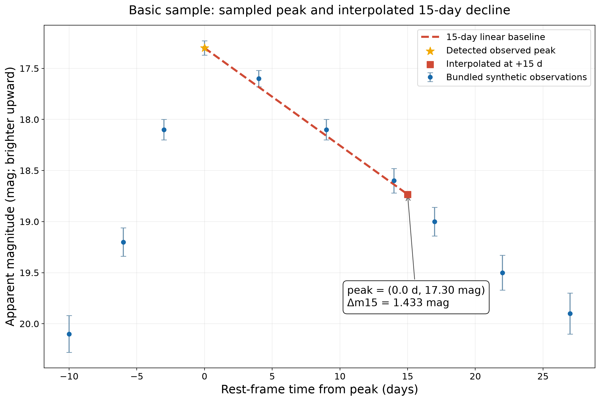 [JPG](figures/01_basic_sample.jpg)

### B. SALT3 — bundled multiband sample

40 measurements in SDSS g/r/i/z were fit with redshift fixed to 0.5, model covariance enabled, min S/N=5, no explicit bounds, and no failed observations. The fit returned χ²=32.127686, 36 dof, reduced χ²=0.892436. Parameters and errors: t0 55100.470310±0.428665 d; x0 1.17510793e−5±4.40662158e−7; x1 0.5922134±0.3725945; c 0.2298068±0.0332282. The diagnostic x0-only mB is 22.836177±0.040715 mag; the illustrative Tripp result is 41.506686 mag. x1 and c satisfy the broad release sample cuts, but c is close to the upper cut. Runtime: 0.884 s.

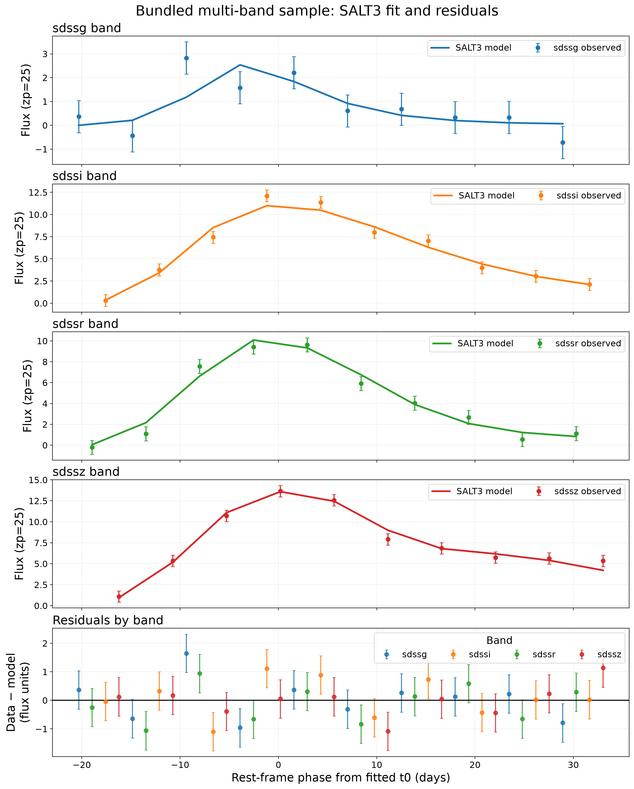 [JPG](figures/02_salt3_fit.jpg)

### C. SALT3 injection–recovery

The pinned model files were available offline. With fixed seed 20261106, 100 synthetic light curves used z=0.5, t0=55110 d, x0=1.34673826e−5, x1=0.4, c=0.05, the bundled 40-row cadence/bands, and each row's supplied fluxerr as independent Gaussian noise. The program's own fitter converged on all 100. Bias and sample standard deviation of recovered minus truth:

| Quantity | Bias | Scatter (sample SD) |
|---|---:|---:|
| t0 (d) | +0.022669 | 0.362823 |
| x1 | −0.024680 | 0.356005 |
| c | +0.000156 | 0.022936 |
| mB from x0 (mag) | −0.002001 | 0.029392 |

Runtime: 11.795 s. This is a software recovery check under the bundled cadence/noise, not a survey-performance claim.

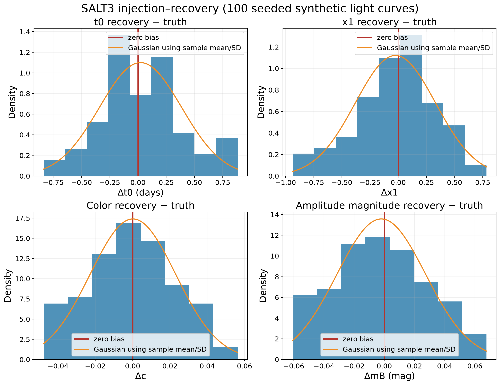 [JPG](figures/03_salt3_injection_recovery.jpg)

### D. DES-Dovekie

The 1,820-row full `STAT+SYS` precision result is δ=−0.0114760829±0.0047706570 mag, χ²=1635.555246, dof=1819, χ²/dof=0.899151. The report's marginal-diagonal approximation, using `diag(P⁻¹)` rather than `MUERR²`, gives δ=−0.0076144277±0.0037712019 mag and χ²/dof=0.842662. Across all rows, residual RMS is 0.268251 mag and scaled MAD is 0.161973 mag; RMS for the 1,719 rows with `PROBIA_BEAMS ≥ 0.5` is 0.169114 mag. The remaining 101 rows are retained in the fit and shown without bars in the redraw; their maximum `MUERR` is 468.0108 mag. Redshift range is 0.02509–1.14418.

04a's residual panel and 04b use y limits −1.2 to 3.2 mag. 04a's absolute-modulus panel retains a physical μ range. Both plots use marginal error bars for the 1,719 rows with `PROBIA_BEAMS≥0.5`; the 101 rows below 0.5 are gray markers without bars, and the legend gives their count and maximum `MUERR`.

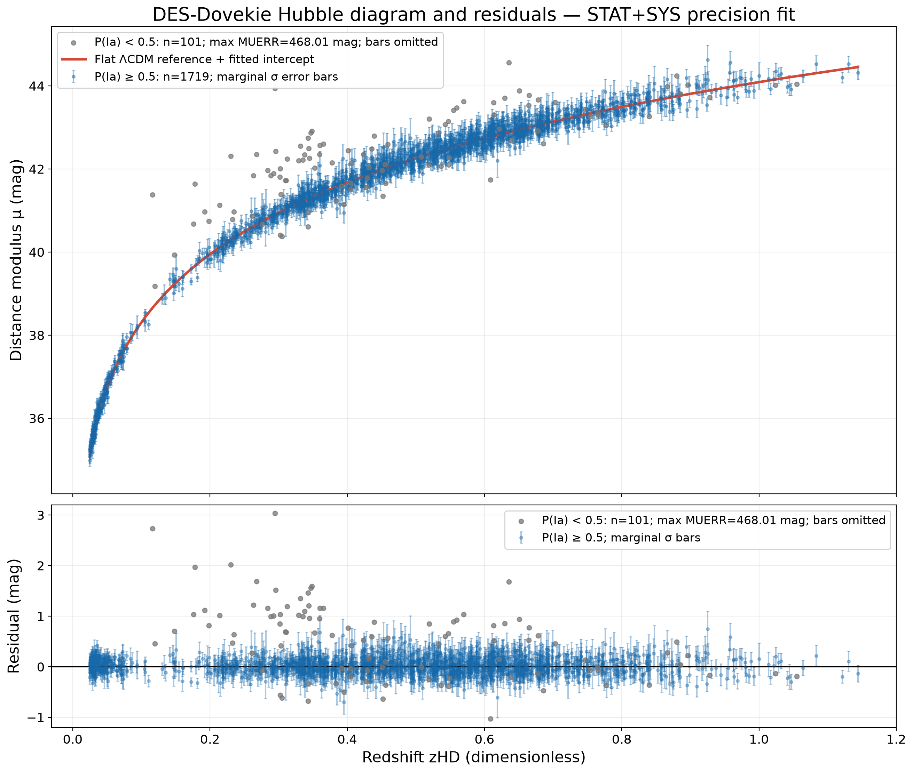 [JPG](figures/04a_dovekie_hubble.jpg)

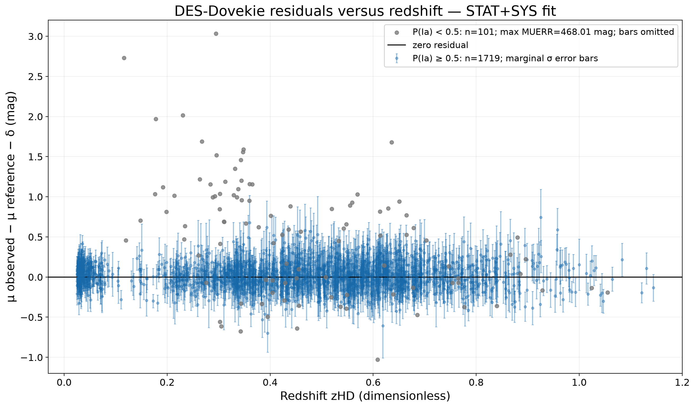 [JPG](figures/04b_dovekie_residuals.jpg)

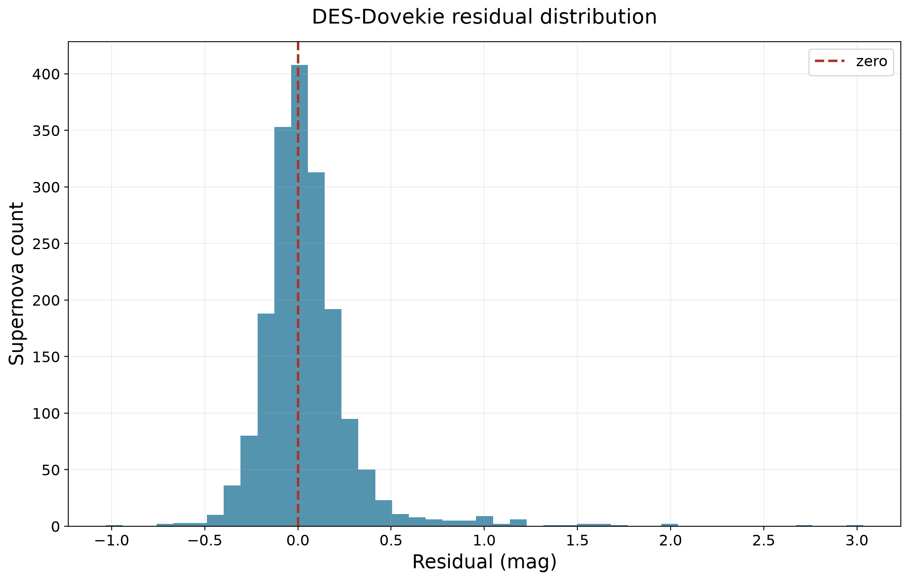 [JPG](figures/04c_dovekie_residual_hist.jpg)

### E. Pantheon+

The complete release data vector has 1,701 rows; 77 `IS_CALIBRATOR==1` calibrators are shown separately and excluded, leaving 1,624 non-calibrator rows (`zHD=0.00299–2.26137`). The full STAT+SYS covariance principal submatrix gives δ=−0.1104084964±0.0036805129 mag; χ²=1460.061865, dof=1623, reduced χ²=0.899607. The marginal-diagonal approximation, using `diag(C)` rather than `MU_SH0ES_ERR_DIAG²`, gives δ=−0.1084844878±0.0036538152 mag; χ²/dof=0.860480. Standard Pantheon+ cosmology uses zHD>0.01 and 1,580 rows; the 44 non-calibrator rows at zHD≤0.01 add Δχ²=70.3 and shift δ from −0.10900 to −0.11041 mag in the reviewer's comparison. The common cross-catalog interval starts at z=0.02509 and excludes these 44 rows. Covariance plots show the full 1,624×1,624 correlation matrix and the first 120 retained rows, plus the ascending eigenvalue spectrum.

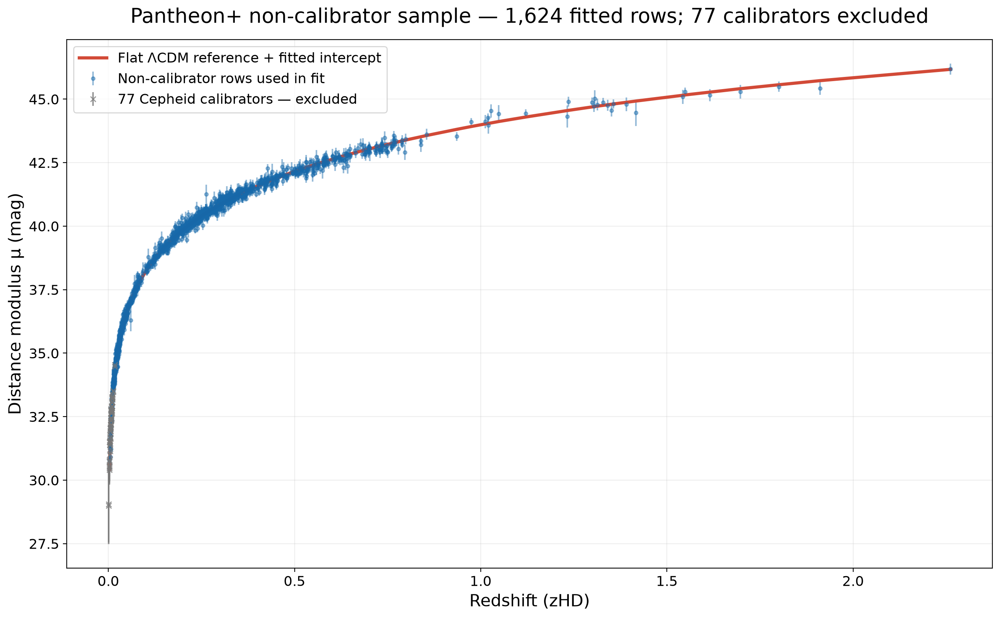 [JPG](figures/05a_pantheon_hubble.jpg)

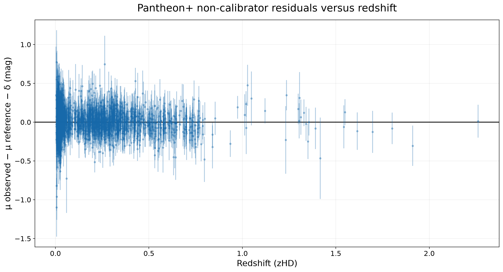 [JPG](figures/05b_pantheon_residuals.jpg)

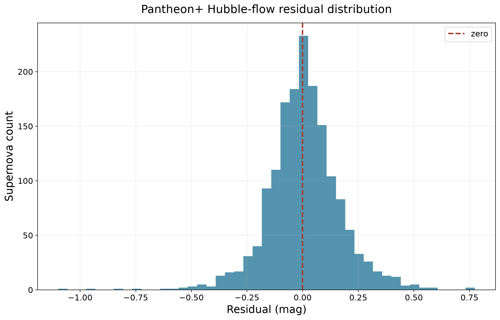 [JPG](figures/05c_pantheon_residual_hist.jpg)

Both correlation panels use color limits −0.2 to +0.2.

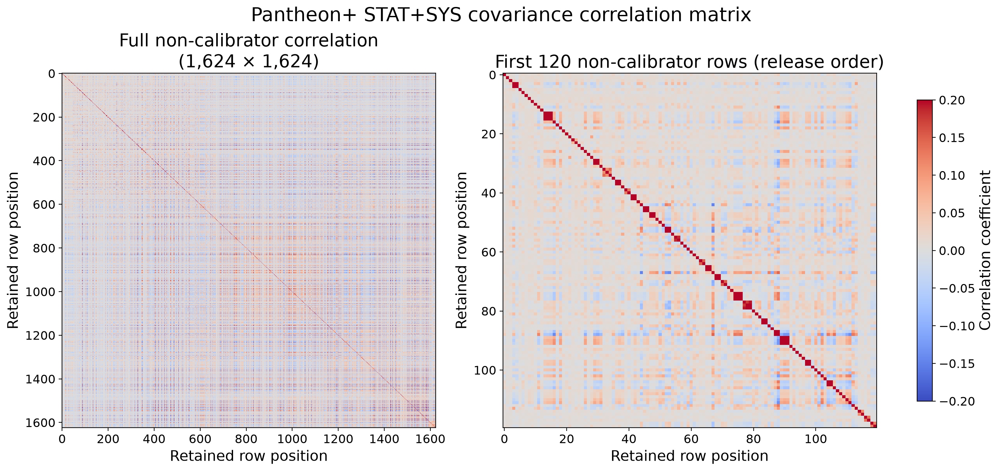 [JPG](figures/05d_pantheon_correlation.jpg)

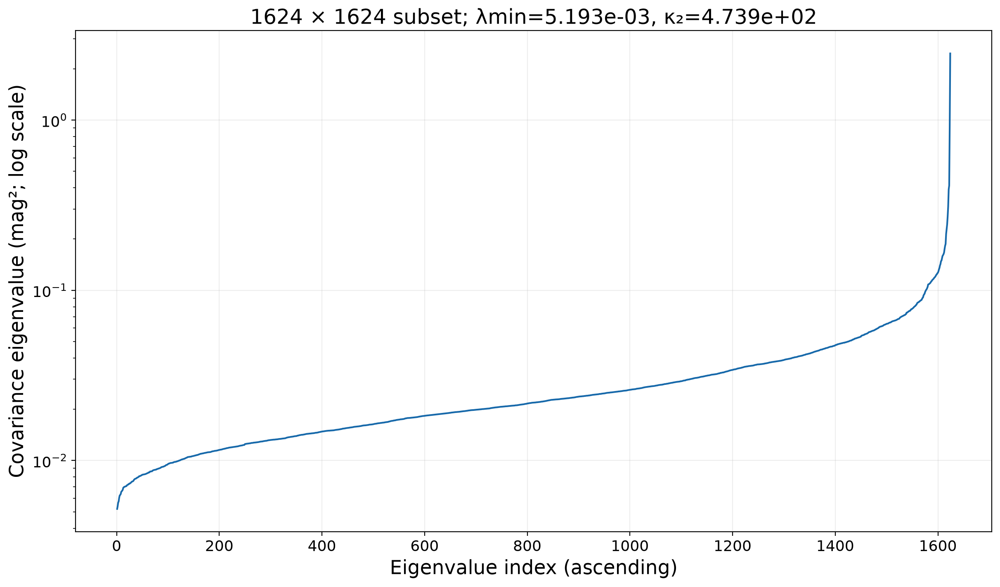 [JPG](figures/05e_pantheon_eigenvalues.jpg)

### F. Covariance consistency

| Check | DES-Dovekie precision P | Pantheon+ covariance C |
|---|---|---|
| Dimension tested | 1,820 | Full 1,701; non-calibrator subset 1,624 |
| Symmetry | max abs difference 0 | full max abs difference 3.00×10⁻⁸; subset 0 after principal subsetting |
| Positive definite | Cholesky succeeded; min eigenvalue(P)=4.56550×10⁻⁶ | Cholesky succeeded for full and subset; subset λmin=0.00519275 mag², λmax=2.46107 mag², κ₂=473.943 |
| Matrix marginal error / displayed release column | √diag(P⁻¹)/MUERR: median ratio 1.026310; range [0.99999998,3.137132] | √diag(C)/MU_SH0ES_ERR_DIAG: median ratio 0.713626; range [0.205576,1.007519] |
| Whitened residual mean | 0.045076 | 0.018871 |
| Whitened residual sample SD | 0.947163 | 0.948288 |
| χ²/(N−1) from whitened vector | 0.899151 | 0.899607 |

Whitening uses `P=LLᵀ, w=Lᵀ(r−δ1)` for DES precision and `C=LLᵀ, w=L⁻¹(r−δ1)` for Pantheon+ covariance. In either case Σw² is the full-matrix χ². Both histograms are broadly close to N(0,1); SDs and χ² ratios are below one. **PASS:** DES has `diag(P⁻¹)=MUERR²+MUERR_SYS²` exactly, so the ratio against MUERR alone rises where the systematic diagonal contributes. Pantheon+ `MU_SH0ES_ERR_DIAG²` is approximately `diag(STAT+SYS)+diag(STATONLY)` (median variance ratio 0.992), not `diag(STAT+SYS)`; the release README says these columns are for plotting and must not be used for cosmological fitting. The report-only diagonal fit therefore correctly uses matrix marginal variances `diag(P⁻¹)` and `diag(C)`. The app itself uses full matrices and does not perform these diagonal-only comparison fits.

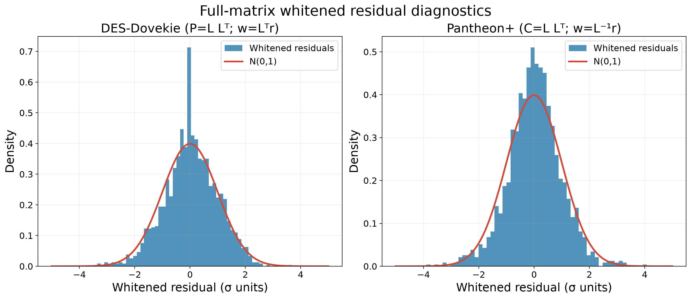 [JPG](figures/06_whitened_residuals.jpg)

### G. Independent recomputation from raw files

`independent_recompute.py` imports only NumPy and pandas plus Python standard-library modules; it does not import `supernova_analyzer`. It independently reads the raw official HD/table and matrix files, applies `IS_CALIBRATOR==0` in source order, uses the same fixed reference cosmology and frame correction, and evaluates GLS contractions / chi-square. Absolute differences versus package outputs:

| Catalog | Δ intercept (mag) | Δ σ (mag) | Δ χ² | Δ reduced χ² |
|---|---:|---:|---:|---:|
| DES-Dovekie | 2.895×10⁻¹⁵ | 0 | 2.115×10⁻¹¹ | 1.166×10⁻¹⁴ |
| Pantheon+ | 6.564×10⁻¹⁵ | 4.337×10⁻¹⁹ | 4.184×10⁻¹¹ | 2.576×10⁻¹⁴ |

Status PASS; independent script runtime 0.486 s. Raw-file hashes were unchanged according to the validator.

### H. H0 invariance

For a fixed flat-ΛCDM shape, changing H0 rescales all luminosity distances by (1/H_0), so the reference modulus changes by one constant, −5 log10(H0,new/H0,old). The fitted nuisance intercept absorbs the equal-and-opposite shift. Therefore each catalog's post-fit residuals, and the bin medians/differences, are invariant except for floating-point roundoff. Observed maximum changes from H0=70:

| Reference H0 (km s⁻¹ Mpc⁻¹) | Maximum per-row residual change (mag) | Maximum 10-bin median-difference change (mag) |
|---:|---:|---:|
| 67 | 8.9651×10⁻¹⁵ | 7.1887×10⁻¹⁵ |
| 70 | 0 | 0 |
| 73 | 9.1316×10⁻¹⁵ | 7.3830×10⁻¹⁵ |

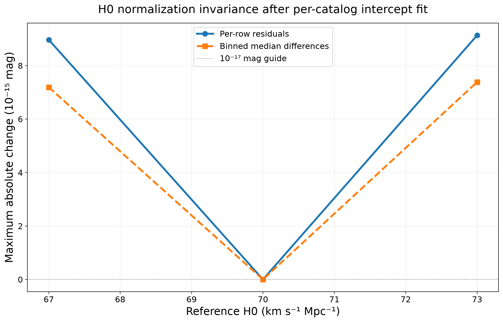 [JPG](figures/08_h0_invariance.jpg)

### I. Cross-catalog comparison and bin sensitivity

The common closed redshift interval is [0.02509, 1.14418]. It contains 1,820 DES-Dovekie rows and 1,303 Pantheon+ non-calibrator rows. The default minimum count is permissive: the z≈0.98 bin has only 6 Pantheon+ rows. Removing the 101 DES rows with PROBIA_BEAMS < 0.5 changes the default 10-bin DES−Pantheon+ median differences by at most 0.0082 mag in the seven bins with ≥51 Pantheon+ rows, and by 0.0192 mag in the z≈0.98 bin, which has only 6 Pantheon+ rows. At 10 bins with minimum count 5 per catalog, 8 bins are eligible and 2 are excluded (Pantheon+ has 3 and 2 rows in those bins). At 20 bins, 14 are eligible/6 excluded; at 30, 21/9. The figure shades/marks bins that do not meet the minimum, and the difference is defined only for eligible bins. Medians are descriptive quantiles, not independent measurement uncertainties.

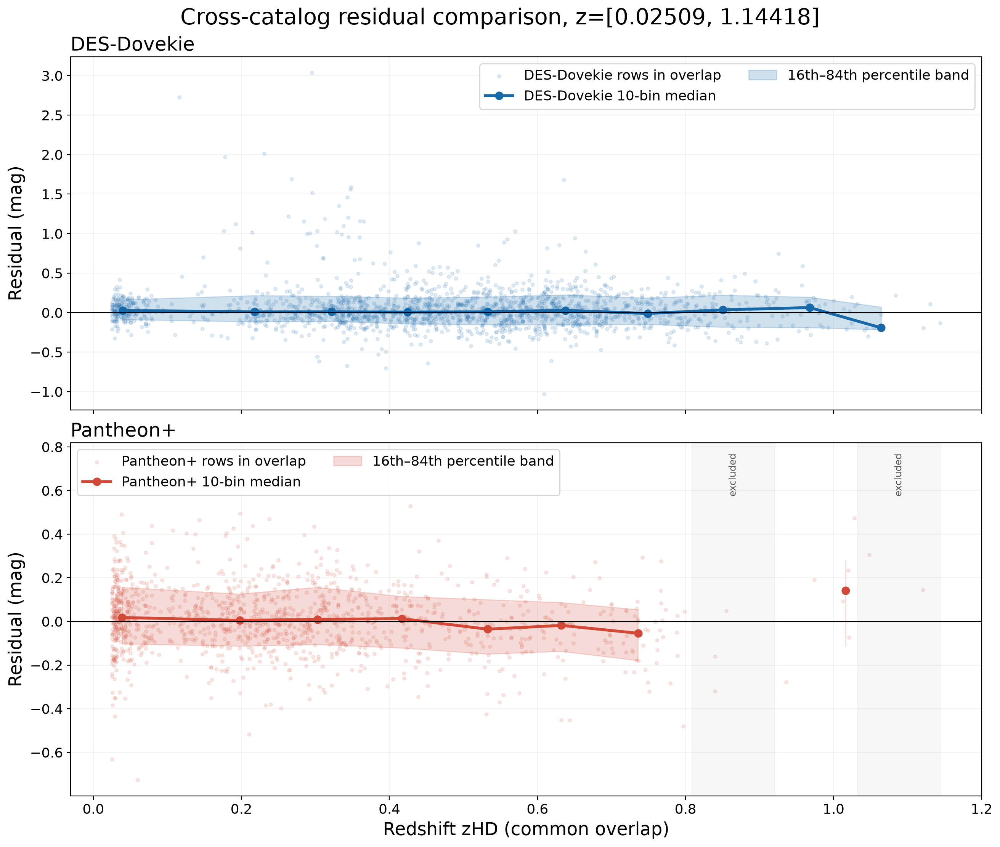 [JPG](figures/09a_cross_catalog_residuals.jpg)

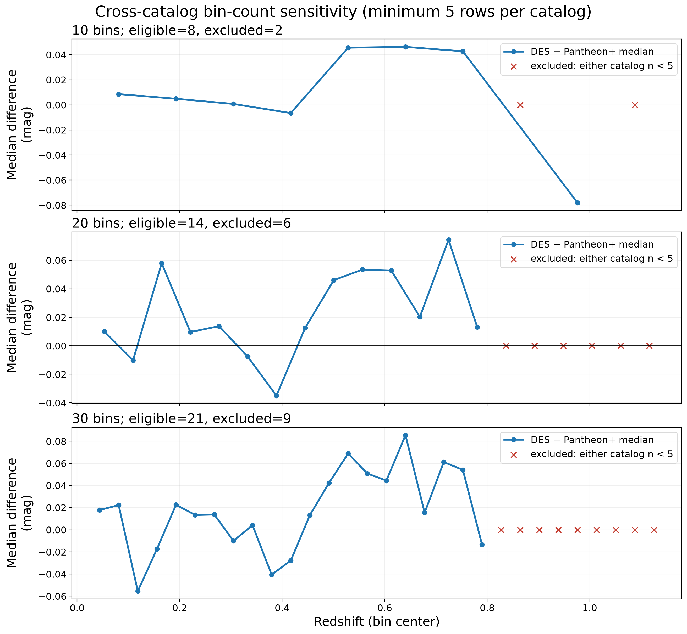 [JPG](figures/09b_cross_catalog_bin_sensitivity.jpg)

### J. Runtime, tests, Ruff, and validator

| Job | Observed runtime/result |
|---|---|
| Basic sample calculation/figure | 0.313 s; PASS |
| SALT3 sample fit/figure | 0.884 s; PASS |
| 100 SALT3 injection fits | 11.795 s; PASS |
| Two official catalog fits, eigenspectrum/whitening, figures | 5.153 s combined; PASS on retry |
| Independent raw-file recomputation | 0.486 s; PASS |
| Offline pytest (`-m "not integration"`) | 281 passed, 9 deselected, 5.04 s |
| Integration pytest with all local official paths and SALT3 enabled | 9 passed, 281 deselected, 6.89 s |
| Ruff on `app.py cross_catalog_ui.py src scripts tests` | All checks passed |
| Read-only quality validator, no `--manifest` (previous verification run) | Exit 0; sources unchanged; 1.914 s |

**A1 diagnosis and fix:** Before the test became hermetic, at its then-current `tests/test_streamlit_app.py:133`, `app.success` contained `DES-Dovekie data available` (`app.py:799`), `Pantheon+ data available` (`app.py:804`), and `Both catalogs available — analysis ready` (`app.py:824`), all from Cross-Catalog Explorer. Scientific `Analysis complete.` (`app.py:720`) was absent after redshift input changed; stale state returned early at `app.py:713-714`. With the four official-data path variables unset, the original test passed. The test now uses `monkeypatch.delenv` on all four variables; its current assertion is at line 143.

Recovered setup/harness errors (the final reruns are the reported results):

1. First official-catalog report harness attempt: `AttributeError: 'NormalizedDistanceCatalog' object has no attribute 'to_pandas'`. The report-only harness treated the normalized protocol as a catalog wrapper. It was corrected; D-I completed in 5.153 s. No project file was changed.
2. First offline pytest attempt: `FileNotFoundError: [Errno 2] No such file or directory: '<project>/reports/verification_2026-11-06/pytest/offline'`. The report-local basetemp directory was created and the run passed.
3. First test-collection helper attempt: `ModuleNotFoundError: No module named 'cross_catalog_ui'`. That helper invocation used `PYTHONPATH=src` and omitted the root app-helper directory. Corrected collection used `PYTHONPATH=.:src` and succeeded (281 offline, 9 integration nodes).
6. A contact-sheet decode check invoked system Python and failed with `ModuleNotFoundError: No module named 'PIL'`. The same check passed under the project `.venv`; the JPG decodes and contains all 15 figure copies.
4. Initial maintenance integration run with only the four catalog variables supplied reported 4 passed/5 skipped because other tests require local legacy DES, metadata, and STATONLY paths. Those local release paths were supplied on the complete rerun; all 9 integration tests passed.
5. First temporary BEAMS-filter rebin helper raised `CrossCatalogError: Residual result row fields must have equal lengths.` after filtering rows without updating the temporary result count. The helper was corrected and rerun. It showed the ≤0.0082 mag change across the seven bins with at least 51 Pantheon+ rows and the 0.0192 mag change in the z≈0.98 bin with six rows.

### K. Local release count/header check

No README file was found under `data/external`; the local data files themselves do not state expected row totals. The DES-Dovekie HD file declares these definitions in its local header:

```text
# zHD = redshift in CMB frame with VPEC correction
# zHEL = helio redshift (beware: no VPEC corr)
# MU = distance modulus corrected for bias and contamination
# MUERR = stat-uncertainty on MU
VARNAMES: CID IDSURVEY zHD zHEL MU MUERR MUERR_VPEC MUERR_SYS PROBIA_BEAMS
```

The Pantheon+ file begins with a column-name header that includes `zHD`, `zHEL`, `MU_SH0ES`, `MU_SH0ES_ERR_DIAG`, and `IS_CALIBRATOR`; it has no count declaration. The observed values were: DES-Dovekie 1,820 rows, zHD 0.02509–1.14418; Pantheon+ 1,701 rows, 77 calibrators, 1,624 non-calibrator rows, zHD 0.00299–2.26137. These are validated against the files' own schema and covariance dimensions, not against an absent local README or an internet source.

### 2.1 Figure set

There are 15 unique figures. Each has a 200 dpi PNG and a JPG copy. The tiled overview is [contact_sheet.jpg](contact_sheet.jpg).

## External cross-check (reviewer, public GitHub releases)

The independent reviewer reports reproducing the headline DES-Dovekie and Pantheon+ `δ`, `σδ`, `χ²`, eigenvalue/condition, marginal-error-ratio and whitened-residual statistics shown above to all printed digits, and reproducing cross-catalog counts and bin eligibility. In the common redshift interval there are 1,820 DES rows and 1,303 Pantheon+ rows. For 10, 20, and 30 bins, eligible/excluded bin counts are 8/2, 14/6, and 21/9. These are the reviewer's external checks against public releases; the program itself does not fit cosmological parameters.

The reviewer also reports data-integrity flat-ΛCDM fits of Ωm=0.333±0.018 for Pantheon+ (`zHD>0.01`, 1,580 rows; paper value 0.334±0.018) and Ωm=0.330±0.015 for DES-Dovekie (paper value 0.330±0.015). These are reviewer calculations, not a Supernova Analyzer feature and not a reproduction performed in this report.

## Documentation mismatches found

The updated current-method documents describe implemented DES-Dovekie/Pantheon+ adapters, three Streamlit tabs, the requested non-calibrator counts/redshift range, and the release-specific diagonal-error semantics. The archived pre-integration body in `docs/recovery/STATUS.md` was not rewritten; its heading now labels it as superseded by main.

## Final verdict: checks and unresolved items

- **PASS — BEAMS-filter sensitivity:** Removing the 101 DES rows with PROBIA_BEAMS < 0.5 changes the default 10-bin DES−Pantheon+ median differences by at most 0.0082 mag in the seven bins with ≥51 Pantheon+ rows, and by 0.0192 mag in the z≈0.98 bin, which has only 6 Pantheon+ rows.
- **PASS — F matrix checks:** symmetry, positive-definiteness, whitening, and release-specific error-column definitions are consistent with the matrices. Marginal-diagonal comparison fits use `diag(P⁻¹)` and `diag(C)`; they are report-harness calculations only.
- **PASS — A/B/C/D/E/G/H/K:** sample peak/dm15, SALT3 fit and 100/100 recovery, catalog fits, independent raw-file recomputation, H0 invariance, and local file/header count checks.
- **PASS — J:** offline and official-path integration pytest, Ruff, and read-only validator (exact new test counts/timings are in §J).
- **Scope:** descriptive residual comparison only; no H0 or Ωm inference by the program, joint likelihood, Pantheon+/Cepheid likelihood, cross-catalog covariance, object matching, or tension significance.
